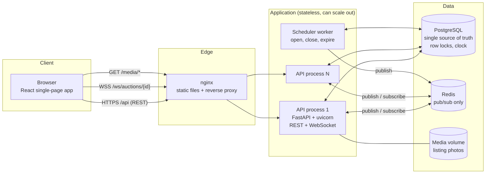
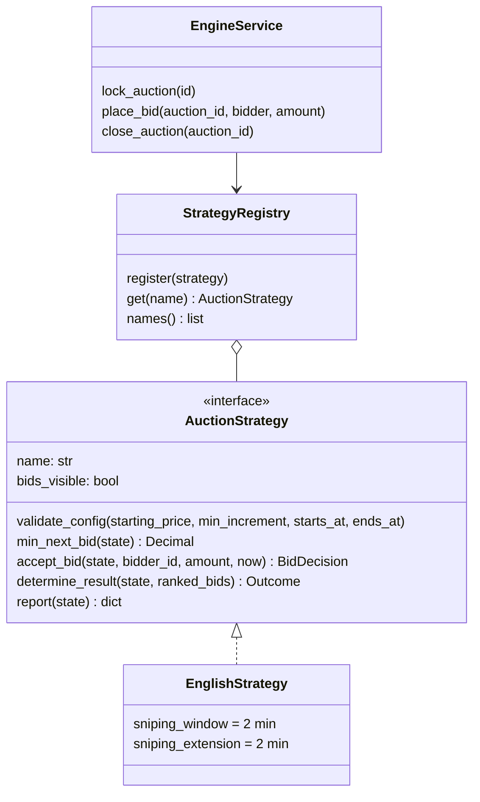
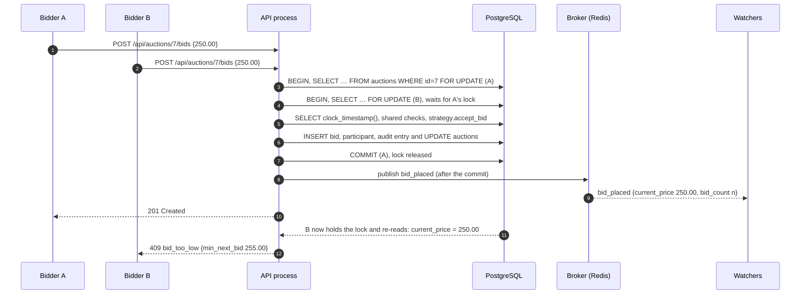
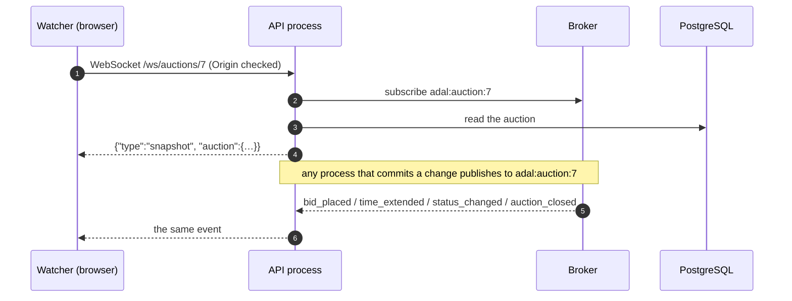
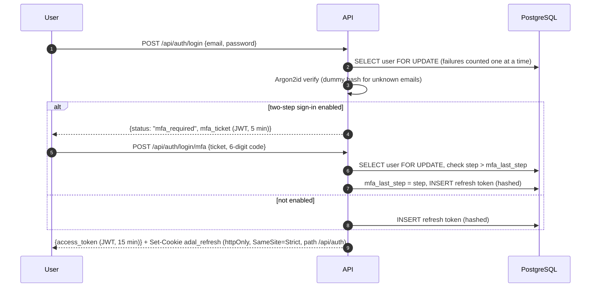
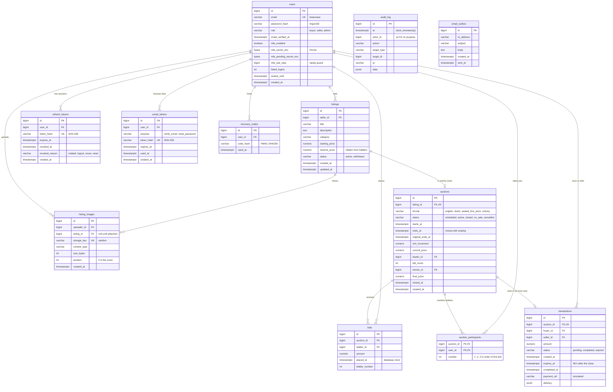
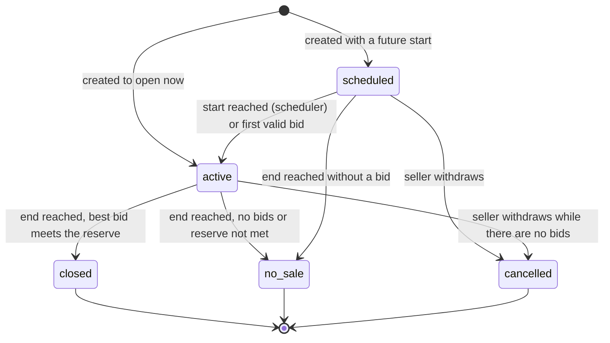
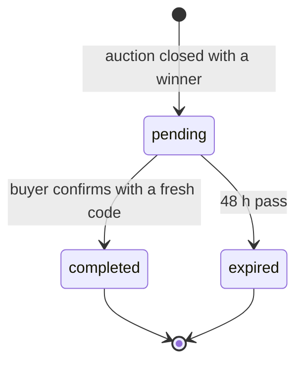

# Adal system design

This document describes how the fall 2026 MVP is built: the components, how a bid travels through them, how correctness is kept under simultaneous bids, the security model, and the full database schema. The HTTP and WebSocket contract is in [API.md](API.md); requirement IDs (FR, NFR, DR, UC) refer to *Online Auction Service, Requirements and Design v2*.

## 1. What the system must guarantee

| Requirement | Target | Where it is handled |
|---|---|---|
| NFR-1 Concurrency correctness | One winner and one price under simultaneous bids; no bid lost, accepted twice or checked against stale state | Row lock per auction, database clock, constraints (sections 5 and 9) |
| NFR-2 Determinism | Ties, no bids, reserve not met, bid at close and sniping always resolve the same way | Engine rules plus a fixed tie-break order |
| NFR-3 Real-time latency | 95% of watchers see a bid within 1 s (200 watchers per auction, 20 active auctions) | WebSocket per watcher, events pushed after commit (section 6) |
| NFR-4 Bid throughput | Validate and commit a bid in under 300 ms at p95 | One short transaction per bid; the lock is held for a few milliseconds |
| NFR-5, NFR-6 Security | OWASP Top Ten 2021 A01, A02, A03, A05, A07, A09; a stolen session alone cannot complete a purchase | Section 8 |
| NFR-7 Extensibility | A new auction format is one strategy module | Strategy registry (section 4) |
| NFR-9 Durability | Accepted bids survive restarts; auctions close on time after a restart | PostgreSQL is the only state; the scheduler catches up on its next tick |
| NFR-11 Portability | Runs in Docker on any host | Docker Compose (section 10) |
| NFR-12 Auditability | Audit entries record who, what and when, and cannot be edited | Append-only table guarded by a trigger |

## 2. Architecture



| Component | Responsibility | State |
|---|---|---|
| React app | Screens from the design handoff; holds the access token in memory; keeps one WebSocket open per watched auction | None that matters: a reload rebuilds it from the API |
| nginx | Serves the built app, proxies `/api`, `/ws`, `/media`, adds security headers | None |
| API process | REST endpoints, WebSocket endpoint, auction engine, validation, authorization | None between requests (rate-limit counters are per process, see section 11) |
| Scheduler worker | Opens scheduled auctions, closes ended ones, expires unpaid sales, once per second | None |
| PostgreSQL | Every durable fact: accounts, listings, auctions, bids, sales, audit log, email outbox. Its row locks serialize bids and its clock decides time | All of it |
| Redis | Carries auction events between processes. Losing a message only means a watcher misses an update until its next snapshot | None durable |

In local development the same code runs as one process: the scheduler runs inside the API, events go through an in-memory broker instead of Redis, and the Vite dev server plays the role of nginx.

### Backend modules

| Module | Purpose |
|---|---|
| `app/main.py` | Application factory: lifespan (engine, broker, scheduler), middleware, routers, media mount |
| `app/config.py` | Settings from `ADAL_*` variables; secrets have no defaults, origins are validated |
| `app/models.py` | SQLAlchemy models, the schema in section 9 |
| `app/schemas.py` | Request and response models; requests reject unknown fields |
| `app/views.py` | Read models: rows to API shapes (cards, auction detail, transactions) |
| `app/deps.py` | Current user and role gates (`seller_user`, `admin_user`), sessions, shared services |
| `app/engine/` | `base.py` strategy interface and registry, `english.py`, `service.py` locking, bids and the close |
| `app/realtime/` | `broker.py` in-memory and Redis fan-out, `ws.py` the WebSocket endpoint |
| `app/routers/` | `auth`, `listings`, `auctions`, `transactions`, `admin`, `dev` |
| `app/security/` | Password hashing, tokens, TOTP and recovery codes, rate limiter |
| `app/scheduler.py`, `app/worker.py` | The periodic jobs and their standalone process |
| `app/audit.py`, `app/mail.py` | Audit entries and the email outbox, written inside the caller's transaction |
| `migrations/` | Alembic migration that creates the schema and the audit trigger |

## 3. Request lifecycle

Every write follows the same shape:

1. **Validation.** The request body is parsed into a Pydantic model with `extra="forbid"`. Money is a decimal with at most two places, and times must carry a time zone.
2. **Authentication.** The bearer JWT is checked (HS256, fixed algorithm list, required claims, `typ`). The user is then loaded from the database, so a role change takes effect at once.
3. **Authorization.** A role gate (`seller_user`, `admin_user`, `ensure_verified`) runs, followed by an ownership check inside the transaction.
4. **One database transaction.** It takes the locks it needs, reads the clock, applies rules and writes rows, the audit entry and any outgoing email.
5. **Commit.** If anything fails, nothing is written.
6. **Side effects after the commit.** Live events are published, and the response is built from a fresh read.

Errors always have the shape `{"error": {"code", "message", "details"}}`. A lock wait or statement timeout in PostgreSQL becomes `503 busy` with `Retry-After: 1`.

## 4. Auction engine

The design separates **what a format decides** from **what every auction must respect**.



**The engine (`service.py`) owns:**
- the row lock and the database clock;
- the time window: the auction has opened, and the bid arrives strictly before `ends_at` (FR-20);
- status checks;
- "a seller cannot bid on their own auction" (FR-22);
- bidder numbering;
- the reserve check at the close (FR-18);
- creating the single transaction (FR-34);
- the audit entries and the events.

**A strategy owns only the format's rules.** It never touches the database or the clock, so a new format cannot weaken the locking. The four operations in the design document map to `validate_config` (create), `accept_bid` (collect bids), `determine_result` (winner and price) and `report` (result). Ranked bids always come sorted by the shared tie-break: highest amount, then earliest `placed_at`, then lowest id (FR-19).

**English rules (fall MVP).**
- The first bid must be at least the starting price; every later bid at least `current_price + min_increment` (FR-23).
- The current leader cannot outbid themselves. This also absorbs a double click.
- A bid in the last 2 minutes extends `ends_at` by 2 minutes (FR-21).
- At the close the highest bid wins and pays its own amount (FR-24).

**Spring formats** plug in the same way:

| Format | What the strategy does | Extra storage |
|---|---|---|
| Dutch | `min_next_bid` is the clock price computed from `starts_at`, the drop and the interval. `accept_bid` accepts the first valid acceptance and returns an `ends_at` of now, so the close runs at once | Drop amount and interval |
| Sealed first-price | `bids_visible = False`; one bid per buyer | A partial unique index on (auction, bidder) for sealed auctions, or a check under the lock |
| Vickrey | As sealed; `determine_result` returns the higher of the second bid and the reserve | None |

## 5. Concurrency design

### One bid, step by step



1. **Lock and reload.** `SELECT … FOR UPDATE` on the auction row, with `populate_existing` so the ORM never returns a cached copy. Bids on the same auction wait here one at a time. Other auctions lock other rows and are not affected.
2. **Clock.** `clock_timestamp()` is read after the lock is held. This is the only time authority (DR-1); the browser's clock never decides.
3. **Checks and decision.** The shared rules run first, then the strategy, against the state as of the lock.
4. **Writes.** The bid, the bidder's number, the new price, leader and end time, and the audit entry, all in one transaction.
5. **Commit, then publish.** Watchers never see a bid that rolled back.

A bid that was the highest when the user clicked cannot overwrite a newer, higher one, because validation always uses the true current state.

### The close

`close_auction` takes the **same row lock**, so a bid and the close cannot interleave. It is idempotent:
- it does nothing unless the auction is still `scheduled` or `active` and the clock has passed `ends_at`;
- a sniping extension simply makes it wait for the new end.

Inside one transaction it ranks the bids, applies the strategy and the reserve check, and either:
- marks the auction `closed`, records `winner_id` and `final_price`, and inserts the transaction, or
- marks it `no_sale`.

In both cases it writes the audit entry and queues the emails.

### What the database enforces

| Invariant | Mechanism |
|---|---|
| One auction per listing | `UNIQUE (auctions.listing_id)` |
| At most one sale per auction, even if the close runs twice in parallel | `UNIQUE (transactions.auction_id)` plus the row lock |
| One number per bidder per auction, numbers never reused | `PRIMARY KEY (auction_id, user_id)`, `UNIQUE (auction_id, number)`, assigned under the row lock |
| Valid statuses and schedules | `CHECK` constraints on every status column, `ends_at > starts_at`, positive prices and increments |
| Reserve never below the starting price | `CHECK (reserve_price IS NULL OR reserve_price >= starting_price)` |
| A buyer is never the seller of the same sale | `CHECK (buyer_id <> seller_id)` |
| Exact money | `numeric(12,2)` everywhere; Python `Decimal`; strings in JSON |
| The audit log cannot be changed | Trigger rejects UPDATE, DELETE and TRUNCATE |
| A TOTP code works once | `users.mfa_last_step` compared and updated under the user row lock |
| A recovery or email token works once | Conditional `UPDATE … WHERE used_at IS NULL` and a row count check, or a row lock |

### Time limits

Every connection sets `lock_timeout = 5s` and `statement_timeout = 15s`. A request that waits too long on a hot auction gets `503 busy` instead of holding a pooled connection. The pool has 20 connections plus 20 overflow per process.

### Why pessimistic locking

The design document compares three approaches: row locks, optimistic versioning with retry, and a per-auction queue. Row locks are the simplest to reason about and to prove correct. A bid holds the lock for a few milliseconds (a handful of indexed statements). That supports far more bids per second on one auction than the NFR-3 load needs. If load tests show contention, the fallback is optimistic versioning (`UPDATE … WHERE bid_count = :seen`).

### Evidence

`backend/tests/test_concurrency.py` sends real concurrent requests:
- 25 identical bids at once → exactly one accepted;
- 25 rising bids at once → every accepted bid stored, applied in order, final price = highest accepted;
- 10 simultaneous closes → exactly one transaction;
- bids racing the close → none stored after the close.

## 6. Live updates



- **Channel.** There is one channel per auction, `adal:auction:{id}`. The event types are `snapshot`, `status_changed`, `bid_placed`, `time_extended` and `auction_closed` (shapes in API.md).
- **No gap between snapshot and events.** The server subscribes before it reads the snapshot. An event can therefore repeat what the snapshot contains, and the client ignores any `bid_placed` whose `bid_count` is not greater than the one it holds.
- **Slow watchers.** Each socket has a 256-message queue. If it fills, the backlog is dropped and the watcher gets a fresh snapshot.
- **Across processes.** Each API process keeps one pattern subscription (`adal:auction:*`) on Redis and fans events out to its local sockets, so a bid on process 1 reaches watchers on process 2. Without Redis the broker works in memory, which is enough for one process.
- **Reconnects.** The client reconnects with backoff; every reconnect starts with a snapshot. While disconnected the page shows "Connection lost" and pauses bidding.
- **Hardening.** Only listed origins may open a socket, incoming messages are capped at 64 KB, and clients never send anything.
- **Sealed formats (spring).** They will publish counts and status only, never amounts.

## 7. Scheduler

`Scheduler.tick()` runs every second, in the API process in development or in the `worker` service under Docker:

| Step | Statement | Notes |
|---|---|---|
| Open | `UPDATE auctions SET status='active' WHERE status='scheduled' AND starts_at <= clock_timestamp() RETURNING id` | Publishes `status_changed`. A bid that arrives first also opens the auction, under its lock |
| Close | Select up to 100 open auctions with `ends_at <= clock_timestamp()`, then `close_auction` for each in its own transaction | Idempotent, same lock as bids |
| Expire | `UPDATE transactions SET status='expired' WHERE status='pending' AND expires_at <= clock_timestamp()` | Writes an audit entry per sale |

Running several schedulers at once is safe, because every step is a conditional update or takes the row lock. After a restart, the first tick closes everything that ended in the meantime (NFR-9).

## 8. Accounts and security

### Sign-in with a second factor



| Credential | Form | Lifetime | Stored as |
|---|---|---|---|
| Access token | JWT HS256, claims `sub`, `role`, `typ=access`, `jti` | 15 min | Browser memory only |
| MFA ticket | JWT HS256, `typ=mfa` | 5 min | Nothing server-side |
| Refresh token | 32 random bytes in an httpOnly, SameSite=Strict cookie scoped to `/api/auth` | 7 days, rotated on every use | SHA-256 in `refresh_tokens` |
| Email link token (verify / reset) | 32 random bytes in the link | 24 h / 1 h, single use | SHA-256 in `email_tokens` |
| TOTP secret | RFC 6238, 6 digits, 30 s, ±1 step | Until changed | Fernet-encrypted in `users.mfa_secret_enc` |
| Recovery codes | 10 codes `xxxx-xxxx` | Single use | HMAC-SHA256 with a derived server key |
| Password | Argon2id | | `users.password_hash`, rehashed when parameters change |

- **Refresh rotation and reuse detection.**
  - Every refresh revokes the presented token (`rotated`) and issues a new one.
  - A rotated token that comes back within 60 s is treated as a harmless race between two tabs.
  - Later than that, it is treated as theft, and every session of the user is revoked.
- **Lockout.** Five failed passwords or codes lock the account for 15 minutes. Failures are counted under the user row lock, so parallel guessing cannot skip the count.
- **Step-up at checkout (FR-5, NFR-6).** Confirming a purchase needs a TOTP code newer than the last one used, even inside a signed-in session. Recovery codes are not accepted there. A buyer without two-step sign-in is asked to set it up first.
- **Rate limits** (sliding window, per process):

| Action | Limit |
|---|---|
| Register | 10 per hour per IP |
| Login | 20 per minute per IP and 10 per minute per email |
| Login code | 20 per minute per IP and 10 per minute per account |
| Resend verification, forgot password | 10 per hour per IP and 3 per hour per email |
| Enable two-step sign-in | 10 per minute per account |
| Bids | 30 per minute per account |
| Photo upload | 30 per 10 minutes per account |
| Checkout confirm | 10 per minute per account |

### Who may do what

| Endpoint group | Rule |
|---|---|
| Browse, auction page, listing page, categories, WebSocket | Public. The reserve amount is shown only to the owner |
| Bid | Signed in, email verified, not an admin, not the seller of this auction |
| Create listing, upload photo, create auction | Seller role, email verified, two-step sign-in on |
| Edit or withdraw a listing | Its seller. Prices are locked after the first bid; withdrawal is refused once bids exist |
| Sales | Buyer or seller of that sale; anyone else gets 404. Only the buyer can confirm |
| Audit log | Admin with two-step sign-in |
| Email outbox | Mounted only when `ADAL_ENV=dev` |

### Other controls

- **Uploads.**
  - The type is decided from the first bytes (JPEG or PNG), never the filename; the limit is 5 MB.
  - Files get a random name, are written with `O_EXCL`, and are served with `nosniff`.
- **Headers.** API responses carry `Content-Security-Policy: default-src 'none'; frame-ancestors 'none'; sandbox`, `X-Content-Type-Options`, `X-Frame-Options`, `Referrer-Policy`, `Cross-Origin-Opener-Policy`, `Cross-Origin-Resource-Policy` and `Cache-Control: no-store`. `Strict-Transport-Security` is added in production. nginx adds a CSP for the app itself.
- **CORS** is off unless `ADAL_CORS_ORIGINS` lists exact origins. Production refuses non-https or local origins.
- **Injection.** Every query goes through SQLAlchemy with bound parameters; `LIKE` wildcards in search are escaped.
- **Audit log.** Audited actions:
  - `auth.*`: registered, email_verified, login, login_failed, login_blocked, locked, password_ok, mfa_failed, mfa_enabled, refresh_reuse, logout, reset_requested, password_reset;
  - listing and auction: `image.uploaded`, `listing.created`, `listing.updated`, `listing.withdrawn`, `auction.created`;
  - bidding: `bid.accepted`, `bid.rejected`, `auction.closed`, `auction.no_sale`;
  - checkout: `transaction.code_rejected`, `transaction.completed`, `transaction.expired`.
- **Personal data (DR-10).** Stored: email, password hash, encrypted TOTP secret, and the delivery address of a completed purchase (visible to its buyer and seller only). No card data exists anywhere: payment is simulated.

## 9. Database schema

PostgreSQL 16 or later.
- **Keys.** Every surrogate key is `bigint GENERATED BY DEFAULT AS IDENTITY`.
- **Time and money.** Every timestamp is `timestamptz` and the session time zone is UTC. All money is `numeric(12,2)`.
- **Constraint names** follow `pk_<table>`, `fk_<table>_<column>_<referred table>`, `uq_<table>_<columns>`, `ck_<table>_<name>` and `ix_<table>_<columns>`.

The schema is created by the Alembic migration `backend/migrations/versions/0001_initial_schema.py`; upgrade and downgrade are both tested.

### Entity relationships



### Tables

#### users

| Column | Type | Null | Default | Notes |
|---|---|---|---|---|
| id | bigint identity | no | | PK |
| email | varchar(320) | no | | Unique; `CHECK (email = lower(email))` |
| password_hash | varchar(255) | no | | Argon2id |
| role | varchar(10) | no | | `CHECK (role IN ('buyer','seller','admin'))`. Sign-up offers buyer or seller only |
| email_verified_at | timestamptz | yes | | Null until the link is opened; bidding and selling need it |
| mfa_enabled | boolean | no | false | Mandatory for sellers (to sell) and admins |
| mfa_secret_enc | bytea | yes | | Active TOTP secret, Fernet-encrypted |
| mfa_pending_secret_enc | bytea | yes | | Secret shown during setup, until the first code confirms it |
| mfa_last_step | bigint | yes | | Last accepted 30 s step; only newer steps are accepted |
| failed_logins | integer | no | 0 | Reset on success; 5 locks the account |
| locked_until | timestamptz | yes | | |
| created_at | timestamptz | no | now() | |

#### email_tokens

| Column | Type | Null | Default | Notes |
|---|---|---|---|---|
| id | bigint identity | no | | PK |
| user_id | bigint | no | | FK → users ON DELETE CASCADE; indexed |
| purpose | varchar(20) | no | | `CHECK (purpose IN ('verify_email','reset_password'))` |
| token_hash | varchar(64) | no | | Unique SHA-256 of the emailed token |
| expires_at | timestamptz | no | | 24 h for verification, 1 h for reset |
| used_at | timestamptz | yes | | Set once; a used token is rejected |
| created_at | timestamptz | no | now() | |

#### refresh_tokens

| Column | Type | Null | Default | Notes |
|---|---|---|---|---|
| id | bigint identity | no | | PK |
| user_id | bigint | no | | FK → users ON DELETE CASCADE; indexed |
| token_hash | varchar(64) | no | | Unique SHA-256 of the cookie value |
| expires_at | timestamptz | no | | 7 days |
| revoked_at | timestamptz | yes | | |
| revoked_reason | varchar(16) | yes | | `rotated`, `logout`, `reuse`, `reset` |
| created_at | timestamptz | no | now() | |

#### recovery_codes

| Column | Type | Null | Default | Notes |
|---|---|---|---|---|
| id | bigint identity | no | | PK |
| user_id | bigint | no | | FK → users ON DELETE CASCADE; indexed |
| code_hash | varchar(64) | no | | HMAC-SHA256 with a key derived from the server secret |
| used_at | timestamptz | yes | | Consumed by `UPDATE … WHERE used_at IS NULL` |

#### listings

| Column | Type | Null | Default | Notes |
|---|---|---|---|---|
| id | bigint identity | no | | PK |
| seller_id | bigint | no | | FK → users; indexed |
| title | varchar(80) | no | | 3 to 80 characters |
| description | text | no | '' | At most 4,000 characters (API) |
| category | varchar(32) | no | | One of the fixed category slugs; indexed |
| starting_price | numeric(12,2) | no | | `CHECK (starting_price > 0)` |
| reserve_price | numeric(12,2) | yes | | `CHECK (reserve_price IS NULL OR reserve_price >= starting_price)`; never sent to bidders |
| status | varchar(12) | no | 'active' | `CHECK (status IN ('active','withdrawn'))` |
| created_at | timestamptz | no | now() | |
| updated_at | timestamptz | no | now() | Updated by the ORM on change |

#### listing_images

| Column | Type | Null | Default | Notes |
|---|---|---|---|---|
| id | bigint identity | no | | PK |
| uploader_id | bigint | no | | FK → users; indexed. Only the uploader can attach it |
| listing_id | bigint | yes | | FK → listings ON DELETE SET NULL; indexed. Null between upload and attach |
| storage_key | varchar(64) | no | | Unique random file name under the media directory |
| content_type | varchar(32) | no | | `image/jpeg` or `image/png`, from the file's bytes |
| size_bytes | integer | no | | At most 5 MB |
| position | integer | no | 0 | Display order; 0 is the cover |
| created_at | timestamptz | no | now() | |

#### auctions

| Column | Type | Null | Default | Notes |
|---|---|---|---|---|
| id | bigint identity | no | | PK |
| listing_id | bigint | no | | FK → listings; **unique**: one auction per listing |
| format | varchar(24) | no | | Strategy name; only `english` is registered in the MVP |
| status | varchar(12) | no | 'scheduled' | `CHECK (status IN ('scheduled','active','closed','no_sale','cancelled'))` |
| starts_at | timestamptz | no | | |
| ends_at | timestamptz | no | | `CHECK (ends_at > starts_at)`; moved later by sniping protection |
| original_ends_at | timestamptz | no | | The end the seller set, kept for reporting |
| min_increment | numeric(12,2) | no | | `CHECK (min_increment > 0)`; fixed amount chosen by the seller |
| current_price | numeric(12,2) | yes | | Null until the first bid |
| leader_id | bigint | yes | | FK → users; the current highest bidder |
| bid_count | integer | no | 0 | `CHECK (bid_count >= 0)`; doubles as the version clients use to order events |
| winner_id | bigint | yes | | FK → users; set when closed with a sale |
| final_price | numeric(12,2) | yes | | |
| closed_at | timestamptz | yes | | Set for closed, no_sale and cancelled |
| created_at | timestamptz | no | now() | |

Indexes: `ix_auctions_status_ends_at (status, ends_at)` for the close query and "ending soon", `ix_auctions_status_starts_at (status, starts_at)` for opening.

#### bids

| Column | Type | Null | Default | Notes |
|---|---|---|---|---|
| id | bigint identity | no | | PK; the last tie-breaker |
| auction_id | bigint | no | | FK → auctions |
| bidder_id | bigint | no | | FK → users; indexed (for "my bids") |
| amount | numeric(12,2) | no | | `CHECK (amount > 0)` |
| placed_at | timestamptz | no | | Database clock read under the lock |
| bidder_number | integer | no | | Copied from auction_participants for cheap history reads |

Index: `ix_bids_auction_ranking (auction_id, amount DESC, placed_at, id)`, the exact FR-19 ranking order, used by the close.

Bids are immutable: a bid is a binding offer (DR-8). There is no update path in the application.

#### auction_participants

| Column | Type | Null | Default | Notes |
|---|---|---|---|---|
| auction_id | bigint | no | | PK part; FK → auctions |
| user_id | bigint | no | | PK part; FK → users |
| number | integer | no | | `UNIQUE (auction_id, number)`; bidders are shown as "Bidder 3", never by name |

#### transactions

| Column | Type | Null | Default | Notes |
|---|---|---|---|---|
| id | bigint identity | no | | PK; shown as reference `TX-000042` |
| auction_id | bigint | no | | FK → auctions; **unique**: exactly one sale per auction |
| buyer_id | bigint | no | | FK → users; indexed |
| seller_id | bigint | no | | FK → users; indexed; `CHECK (buyer_id <> seller_id)` |
| amount | numeric(12,2) | no | | `CHECK (amount > 0)`; the final price |
| status | varchar(12) | no | 'pending' | `CHECK (status IN ('pending','completed','expired'))` |
| created_at | timestamptz | no | | The close time (database clock) |
| expires_at | timestamptz | no | | `created_at + 48 h` |
| completed_at | timestamptz | yes | | |
| payment_ref | varchar(40) | yes | | `SIM-…`; payment is simulated |
| delivery | jsonb | yes | | `{full_name, address, city, postal_code}` given at checkout |

#### audit_log

| Column | Type | Null | Default | Notes |
|---|---|---|---|---|
| id | bigint identity | no | | PK |
| at | timestamptz | no | clock_timestamp() | |
| actor_id | bigint | yes | | No foreign key on purpose: the log outlives accounts |
| action | varchar(64) | no | | Indexed; the action names are listed in section 8 |
| target_type | varchar(32) | yes | | `user`, `listing`, `auction`, `transaction`, `image` |
| target_id | bigint | yes | | |
| ip | varchar(45) | yes | | Client address as seen by the API |
| data | jsonb | no | '{}' | Small facts, for example `{"amount": "250.00", "bidder_number": 2}` |

The migration installs:

```sql
CREATE FUNCTION audit_log_append_only() RETURNS trigger LANGUAGE plpgsql AS $$
BEGIN
    RAISE EXCEPTION 'audit_log is append-only';
END
$$;
CREATE TRIGGER audit_log_no_change BEFORE UPDATE OR DELETE ON audit_log
    FOR EACH ROW EXECUTE FUNCTION audit_log_append_only();
CREATE TRIGGER audit_log_no_truncate BEFORE TRUNCATE ON audit_log
    FOR EACH STATEMENT EXECUTE FUNCTION audit_log_append_only();
```

In production the application should connect as a role that does not own the table, so it also cannot disable the trigger.

#### email_outbox

| Column | Type | Null | Default | Notes |
|---|---|---|---|---|
| id | bigint identity | no | | PK |
| to_address | varchar(320) | no | | |
| subject | varchar(200) | no | | |
| body | text | no | | May contain one-time links: never logged |
| created_at | timestamptz | no | now() | |
| sent_at | timestamptz | yes | | For a future delivery worker; nothing sends mail yet |

Rows are written in the same transaction as their cause (registration, sale, completed purchase), so an email is queued exactly when its event commits.

### State machines





No transition leaves `closed`, `no_sale`, `cancelled`, `completed` or `expired`.

### Main queries and the indexes they use

| Query | Index |
|---|---|
| Lock one auction by id (every bid, the close) | `pk_auctions` |
| Auctions to close: `status IN (…) AND ends_at <= now()` | `ix_auctions_status_ends_at` |
| Auctions to open: `status = 'scheduled' AND starts_at <= now()` | `ix_auctions_status_starts_at` |
| Rank bids at the close | `ix_bids_auction_ranking` |
| Bid history (newest 50) | `ix_bids_auction_ranking` (filter by auction), then sort |
| Bidder number lookup | `pk_auction_participants` |
| Browse by status with sort | `ix_auctions_status_ends_at`; text search uses `ILIKE` (fine at this scale; `pg_trgm` later) |
| Session refresh, email links | `uq_refresh_tokens_token_hash`, `uq_email_tokens_token_hash` |

## 10. Deployment

`docker compose up --build` starts:

| Service | Image | Role |
|---|---|---|
| db | postgres:17-alpine | Data, volume `db-data` |
| redis | redis:8-alpine | Event fan-out |
| migrate | backend image | `alembic upgrade head`, then exits |
| api | backend image | uvicorn, `ADAL_SCHEDULER_ENABLED=false`, volume `media` |
| worker | backend image | `python -m app.worker` |
| web | frontend image (nginx, unprivileged) | Port 8080; serves the app and proxies the rest |

| Setting | Meaning |
|---|---|
| `ADAL_ENV` | `dev`, `test` or `prod`. `prod` hides the API explorer, adds HSTS and requires https origins |
| `ADAL_DATABASE_URL` | `postgresql+asyncpg://…` |
| `ADAL_REDIS_URL` | Enables the Redis broker; needed with more than one API process or a separate worker |
| `ADAL_JWT_SECRET` | At least 32 characters; signs tokens and derives the recovery-code key |
| `ADAL_MFA_ENCRYPTION_KEY` | Fernet key for TOTP secrets |
| `ADAL_FRONTEND_URL`, `ADAL_CORS_ORIGINS` | Exact origins for links, CORS and WebSocket checks |
| `ADAL_COOKIE_SECURE` | Must be true behind https |
| `ADAL_SCHEDULER_ENABLED` | Run the scheduler inside this process |

Scaling path:
- **API processes.** Add more behind nginx once Redis is configured; they hold no state.
- **Scheduler.** One worker is enough, and more are safe.
- **Database.** PostgreSQL is the only component that limits a single hot auction, because its bids are serialized by design. Different auctions scale independently.

CI (GitHub Actions, `.github/workflows/`) runs on every push to `main` and every pull request. It runs the backend tests against PostgreSQL 17 and the front-end type-check and build. It smoke-tests this Compose stack: build, start, seed demo data, then load the site, the API and a photo through nginx. It also checks every lockfile against the OSV vulnerability database, and that scan runs weekly as well.

## 11. Known limits and next steps

| Item | Plan |
|---|---|
| Rate limits are counted per process | Move the counters to Redis before running several API processes |
| Photos are type-checked but not re-encoded (metadata kept) | Re-encode on upload and strip EXIF |
| Email is queued, not sent | A delivery worker that sends `email_outbox` rows and sets `sent_at` |
| NFR-3 and NFR-4 are not measured yet | Locust or k6 load test: 200 watchers × 20 auctions, bid latency at p95 |
| Spring formats, notifications, admin dashboard, flagging | New strategies in `engine/`, new tables for notifications and flags |
| Search uses `ILIKE` | `pg_trgm` index or full-text search when the catalogue grows |
| Bids and the audit log grow forever | Monthly partitions and archiving once volume requires it |
| Base images referenced by tag | Pin by digest, and scan the built images in CI |
